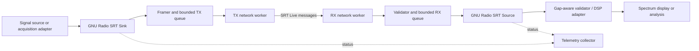

# GNU Radio SRT Transport Module — Developer Project Plan

**Project:** `gr-robotweax-srt`  
**Document version:** 1.0  
**Date:** 2026-11-12  
**Status:** Proposed implementation specification; no implementation or benchmark result is claimed  
**Initial deliverable:** Independently installable GNU Radio out-of-tree module  
**Primary integration:** Robotweax SRT public C API

## 1. Purpose and success criteria

Build reusable GNU Radio blocks that carry continuous numeric sample streams over an impaired IP network, with bounded buffering, observable discontinuities, and predictable shutdown. The first demonstration is a remote measurement station sending complex I/Q samples to a receiver that validates samples and displays a spectrum.

The project has two independent success conditions:

1. **Engineering correctness:** Delivered sample values, ordering, sample coordinates, discontinuity reports, and lifecycle behavior meet this specification. No network impairment may silently corrupt the measurement timeline.
2. **Use-case benefit:** At a declared sample rate and latency budget, SRT delivers a higher fraction of usable, timely samples than an appropriate baseline on at least one predeclared impaired-network profile. A correct implementation without this benefit is still valid software, but does not justify a performance or product claim.

The deliverable is an application integration, not a new SRT implementation. Preserve transport compatibility wherever possible. The new measurement payload requires matching application endpoints; arbitrary SRT media players will not understand it.

### Intended users

- Developers connecting remote measurement or SDR stations to GNU Radio processing.
- Laboratories evaluating continuous data transport over public Internet, mobile, or satellite IP links.
- Device integrators needing sample-aware diagnostics rather than a generic byte pipe.

### First concrete user story

A developer installs the module on two Linux hosts, opens the supplied Companion examples, configures one sender and one receiver, and observes a deterministic test signal. Network impairment can be introduced without an unbounded memory increase or a hung flowgraph. Every omitted interval is reported, and the receiver never treats separated sample intervals as continuous acquisition.

## 2. Evidence, assumptions, and dependency qualification

The existing Robotweax checkout documents a C++20 library, installed C API, CMake target `RobotweaxSRT::srt`, Live and File modes, nonblocking I/O, epoll, and statistics. Its README describes published 0.2.7 and a 0.2.8 candidate. Other integration documents retain older release labels. Therefore, documentation labels alone must not select the implementation baseline.

The checkout inspected for this plan had HEAD:

```text
09ceab33e1fc190472558fdb4d873f38b76fa320
```

This identifies the inspected checkout, not an approved dependency pin or a clean-tree guarantee. At milestone M0, select and record an immutable tested commit and the matching installed headers, binary, build flags, and package version. Do not silently follow `main` or treat `srt_getversion()` as the Robotweax product version.

### Proposed initial qualification platform

| Component | Initial scope | Required qualification record |
|---|---|---|
| OS | Ubuntu 24.04 LTS, Linux x86-64 | Image digest or package manifest, kernel, CPU |
| GNU Radio | One pinned 3.10.x release | Exact version/tag, runtime, development packages, Python bindings |
| Toolchain | C++20-capable compiler, CMake, Ninja | Exact versions and build type |
| Python | Version compatible with selected GNU Radio | Interpreter and binding dependency versions |
| Transport | Pinned Robotweax SRT package | Commit, ABI line, crypto backend, build flags |
| Reference transport | Optional pinned Haivision libsrt build | Exact commit; separate process from Robotweax |
| Second architecture | Linux arm64 after x86-64 gates pass | Independent results, not inferred compatibility |

macOS, Windows, GNU Radio 4, and arbitrary GNU Radio versions are later qualification targets. The initial module uses the GNU Radio 3 runtime and APIs. Compatibility with another generation is not implied.

**M0 blocking checks:** public-header compile, package discovery, Python import, Companion block discovery, nonblocking connect/accept/send/receive, epoll cancellation strategy, socket-option readback, and runtime stop with no peer. Resolve failures before building the full feature set.

## 3. Scope and release boundaries

### Required for v0.1

- One independently installable out-of-tree module.
- Two stream blocks: `srt_sink` and `srt_source`.
- One scalar stream per block instance.
- `f32` and `cf32` sample formats; no vector ports initially.
- SRT Live/Message transport, Caller and Listener roles.
- Both topologies: Sink Caller → Source Listener, and Sink Listener ← Source Caller.
- IPv4 loopback, isolated routed-network, and two-host tests.
- Versioned measurement framing, rational sample rate, explicit sample coordinates.
- Optional capture-time metadata with declared clock domain and uncertainty.
- Strict-stop and segmented-live continuity policies.
- Bounded queues, reconnect policy, startup deadline, and bounded stop.
- Status message ports, snapshot API, structured diagnostic output.
- Companion examples, headless CLI runners, unit/integration tests, and reproducible netem experiments.
- Explicit plaintext local-test mode and passphrase-configured standard AES-CTR mode.

### Excluded from v0.1

- A guarantee of lossless acquisition or durable end-to-end recording.
- SRT File mode, resumable archives, or sender-confirmed completion.
- Arbitrary PMT object transport or remote command execution.
- Multiplexing several sensors in one application stream.
- Rendezvous, NAT traversal orchestration, TURN/VPN services, or public relay hosting.
- Bonding, aggregation, FEC tuning, custom Sensor/Control transport profiles, or GCM extensions.
- Automatic resampling, sample-clock synchronization, RF device configuration, or clock recovery.
- Native browser visualization or replacement of GNU Radio's DSP scheduler.
- Automatic switching of SRT implementations inside one process.

These exclusions limit the first release; they do not prevent later development. The Robotweax-specific Sensor and Control profiles must remain separately negotiated extensions if introduced later.

## 4. Architecture



### Internal components

1. **Wire codec:** Pure C++ encoder/decoder with no GNU Radio or socket dependencies.
2. **Session configuration:** Validated immutable configuration shared with workers.
3. **SRT adapter:** Public C API only; translates transport errors and statistics into internal values.
4. **Session worker:** Owns sockets and epoll registrations; handles connection state and message I/O.
5. **Bounded record queues:** Application records, not arbitrary unbounded byte buffers.
6. **GNU Radio adapters:** Consume/produce items, interpret selected input tags, attach output tags.
7. **Diagnostics:** Atomic counters and bounded event reporting outside hot-path logging.
8. **Test peer:** Headless non-GNU-Radio application using the same codec; used to isolate transport and scheduler failures.

### Proposed repository layout

```text
gr-robotweax-srt/
  CMakeLists.txt
  cmake/
  include/gnuradio/robotweax_srt/
    config.h
    srt_sink.h
    srt_source.h
  lib/
    wire_codec.*
    bounded_record_queue.*
    runtime_owner.*
    srt_adapter.*
    session_worker.*
    srt_sink_impl.*
    srt_source_impl.*
  python/robotweax_srt/
    bindings/
    qa_*.py
  grc/
    robotweax_srt_sink.block.yml
    robotweax_srt_source.block.yml
  examples/
    live_sender.grc
    live_receiver.grc
    headless_sender.py
    headless_receiver.py
    gap_aware_spectrum.py
  tools/
    reference_peer/
    run_matrix.py
    validate_results.py
  tests/
    unit/
    integration/
    fixtures/
    netem/
  docs/
    protocol-v1.md
    block-reference.md
    continuity-and-time.md
    building.md
    benchmarking.md
    compatibility.md
  dependencies.lock.json
  LICENSE
  THIRD_PARTY_NOTICES.md
```

Keep this as a separate project rather than adding GNU Radio dependencies to the SRT core. Source-code changes needed in SRT belong in its own repository and must be qualified independently.

## 5. GNU Radio block API

The following interfaces are proposed project APIs, not existing GNU Radio or Robotweax APIs. Final C++ names may change at M0, but behavior must remain equivalent.

```cpp
enum class sample_format { f32, cf32 };
enum class connection_role { caller, listener };
enum class continuity_policy { strict_stop, segmented_live };

struct transport_config;
struct stream_config;

srt_sink::sptr srt_sink::make(
    const transport_config&, const stream_config&);
srt_source::sptr srt_source::make(
    const transport_config&, const stream_config&);

// Both blocks:
status_snapshot status() const;
```

Bindings expose construction through Python and dictionary-convertible status snapshots. Use pybind11 through the pinned GNU Radio module template. Companion uses the same validation path as direct C++/Python construction.

### Parameters

| Parameter | Default / constraint | Meaning |
|---|---|---|
| `sample_format` | `cf32`; must match both ends | IEEE-754 float32 real or interleaved I/Q |
| `sample_rate_num` | 100000; uint32, nonzero | Numerator in samples/second |
| `sample_rate_den` | 1; uint32, nonzero | Denominator, normalize by GCD |
| `role` | Sink Caller, Source Listener | Connection initiation, independent of sample direction |
| `host` | Caller: required | Numeric IPv4 address for v0.1; DNS later |
| `bind_address` | `127.0.0.1` | Explicitly change for remote access |
| `port` | 9000; 1–65535 | Listener or remote port |
| `stream_id` | `rwsrt/v1/default` | Routing label; not an authentication identity |
| `latency_ms` | 250 | Requested SRT receiver/peer latency |
| `record_limit_bytes` | 1200 total | Includes application header; validate transport ceiling |
| `flush_interval_ms` | 2 | Maximum application assembly residence for a partial record |
| `queue_max_bytes` | 4 MiB per direction | Serialized record storage, excluding declared allocator overhead |
| `queue_max_records` | 8192 per direction | Independent record-count limit |
| `queue_max_age_ms` | 100 | Local application queue residence limit |
| `continuity_policy` | `strict_stop` | Fail on continuity loss; live demo explicitly selects segmented mode |
| `connect_timeout_ms` | 3000 per attempt | Worker-level connect deadline |
| `startup_timeout_ms` | 30000 | No-peer startup deadline; failure becomes terminal |
| `reconnect` | Enabled in segmented mode | Strict mode fails on connection loss after a run starts |
| `reconnect_initial_ms` | 250 | Exponential retry delay |
| `reconnect_max_ms` | 4000 | Delay cap, with ±20% jitter |
| `reconnect_total_timeout_ms` | 60000 | Wall-time budget after an established connection fails |
| `stop_timeout_ms` | 1000 | Target upper bound for normal teardown on reference host |
| `security_mode` | `ctr` | `ctr` or explicit `none`; no automatic downgrade |
| `passphrase_env` | Required for CTR | Name of environment variable, not secret value |
| `status_interval_ms` | 1000 | Snapshot publication interval |

Reject invalid values before starting a worker. For default record size, header leaves 1104 bytes: 276 `f32` or 138 `cf32` samples. Records may contain fewer samples. Before accepting any DATA, Source must compare the wire sample format and normalized rational rate with its configured expectations; mismatch is a terminal configuration/protocol error. Never silently change the sample rate or format to fit a connection.

Connection, framing, format, and queue settings are immutable while running. A later runtime-control API requires its own synchronization and transition contract.

### Ports

- Sink: one input stream, zero output streams, message output `status`.
- Source: zero input streams, one output stream, message output `status`.
- No command input port in v0.1.
- Both use explicit stop/start lifecycle and disable inappropriate automatic tag propagation.

Implement Sink as a general block with explicit consumption accounting. Do not use a synchronous-block return value in a way that claims consumption of samples that were neither framed nor deliberately discarded under the selected policy.

## 6. Wire protocol: RWSR version 1

This section is normative for the proposed first implementation. One complete application record maps to one SRT message. For v0.1, keep each message within the qualified single-packet plaintext ceiling; no application fragmentation or multi-message record reassembly.

### Encoding

All header integers are big-endian. Sample payload uses explicit little-endian IEEE-754 binary32. `cf32` is the ordered pair I, Q, with no padding. Do not serialize native C++ structures or assume `std::complex<float>` memory layout is portable. Preserve float bit patterns, including signed zero and NaN representations, during transport tests.

### Fixed 96-byte header

| Offset | Bytes | Field | Contract |
|---:|---:|---|---|
| 0 | 4 | `magic` | ASCII `RWSR` |
| 4 | 1 | `version` | 1 |
| 5 | 1 | `kind` | 1 DATA, 2 END |
| 6 | 2 | `flags` | Bit 0: capture timestamp valid; other bits zero |
| 8 | 2 | `header_bytes` | 96 |
| 10 | 1 | `sample_format` | 1 f32, 2 cf32 |
| 11 | 1 | `clock_domain` | 0 unavailable, 1 Unix/POSIX nanoseconds |
| 12 | 4 | `payload_bytes` | Exact bytes following header |
| 16 | 16 | `run_id` | Random 128-bit identifier generated at Sink start |
| 32 | 8 | `segment_id` | Starts at 0; increments on unknown upstream continuity loss |
| 40 | 8 | `first_sample_index` | Sample coordinate within segment |
| 48 | 4 | `sample_count` | DATA: positive; END: zero |
| 52 | 4 | `sample_rate_num` | Positive normalized numerator |
| 56 | 4 | `sample_rate_den` | Positive normalized denominator |
| 60 | 4 | `reserved_a` | Zero |
| 64 | 8 | `capture_time_ns` | Signed timestamp of first payload sample, when valid |
| 72 | 8 | `capture_uncertainty_ns` | Unsigned upper uncertainty bound, when valid |
| 80 | 8 | `record_sequence` | Monotonically increasing within run, including END |
| 88 | 8 | `reserved_b` | Zero |

For DATA, `payload_bytes == sample_count * sample_bytes`, using checked arithmetic. `sample_bytes` is 4 or 8. Total message length must equal `96 + payload_bytes`. Reject unknown kinds, versions, flags, formats, invalid reserved fields, and unsupported clock domains. Reject coordinate or sequence wrap; require a new run before exhaustion.

With capture validity clear, clock domain, capture time, and uncertainty must be zero. Valid time requires domain 1. END always has zero payload, zero count, and no capture timestamp. Its sample index is the exclusive end coordinate of the current segment.

### Identity and ordering

- A Sink start creates a new run ID, segment 0, index 0, and record sequence 0.
- An automatic reconnect preserves the same run ID, segment, and coordinate accounting.
- A block restart creates a new run ID; it must not masquerade as continuation.
- Format and rate are invariant within a run. A change requires stopping and a new run.
- Every record carries sufficient format metadata; loss of an initial setup message cannot make later DATA undecodable.
- Record sequence is assigned when a record is assembled. Discarded queued records retain their consumed sequence numbers. Sequence gaps are diagnostic; sample indices quantify missing samples within a segment.
- A repeated or regressing sequence or overlapping sample interval within an active run is a protocol failure. No silent duplicate filtering that could hide a sender bug.
- `segment_id` may advance after an upstream discontinuity. Indices restart at zero for the new segment. The number of missing samples across such a boundary is unknown.
- A fresh receiver joining mid-run marks `initial_join`; it must not claim it observed or verified the preceding stream. Strict mode requires its first DATA to have segment 0, sample index 0, and record sequence 0; otherwise it fails. Segmented mode accepts a mid-run join with the explicit boundary tag. An empty run consists of END with segment 0, index 0, and sequence 0.
- A different run ID on a new connection requires `new_run` handling. Strict mode fails after the first accepted run; segmented mode opens a new output segment and resets its coordinate reference.

Use immutable golden byte fixtures for f32 DATA, cf32 DATA, timed DATA, and END. Include a complete field-by-field example in `protocol-v1.md` generated independently of the production serializer.

### END and finite streams

Natural upstream EOF causes the Sink to flush a partial DATA record and enqueue one END after preceding DATA. Detect upstream completion using the pinned GNU Radio runtime's supported input-completion mechanism; qualify this explicitly in M0. Do not infer EOF from temporary lack of input. A generic user `stop()` is cancellation, not natural EOF.

END lets the receiver detect a missing final DATA interval if END arrives. It does not guarantee delivery of that END. A lost final Live packet may remain unrecovered without later DATA, as documented by Robotweax.

The Source emits accepted queued DATA, reports the END result, then returns `WORK_DONE`. END never causes queued valid data to be silently discarded. A connection close without END is `termination_unknown`, not successful completion. Inactivity is not EOF. If the receiver saw all records after an observed start and END, it may report receiver-observed completeness; the Sink may not claim receiver acknowledgement or durable delivery.

No END retry/acknowledgement subprotocol is included in v0.1. Tests requiring byte-complete finite transport must explicitly check receiver-observed END and the full expected sample sequence; missing END is inconclusive/failing, not success.

## 7. GNU Radio tags and measurement semantics

### Required output tags

Attach tags at absolute output item offsets, accounting for partial record emission across scheduler calls.

| Tag | Value | Placement |
|---|---|---|
| `rwsrt.record` | PMT dictionary: run ID, segment ID, first sample index, count, sequence, rate numerator/denominator | First output sample of every record |
| `rwsrt.discontinuity` | Reason, previous/next coordinates, known missing count or explicit unknown, connection generation | First actual sample after a break |
| `rwsrt.capture_time` | First-sample Unix ns and uncertainty | First sample of a record carrying valid time |

Discontinuity reasons include `initial_join`, `sample_gap`, `upstream_unknown_gap`, `reconnect`, `new_run`, and `receiver_queue_drop`. Multiple causes at one boundary are represented as a bounded reason list, not silently overwritten. Never manufacture samples to carry a tag when no data follows; publish the pending discontinuity as a status event instead.

Source keeps separate **network validation** and **output emission** cursors. Otherwise, frames dropped from its local queue could disappear from continuity accounting. Network gaps, transmitter queue drops, and receiver queue drops are distinct metrics; absence of remote telemetry means a network gap's original cause may remain unknown.

### Input tag contract

MVP accepts two custom input tags at exact input item positions:

- `rwsrt.capture_time`: Unix ns and finite uncertainty for that sample. Split records at the tag. Derive subsequent timestamps using rational sample rate, wide integer arithmetic, and accumulated fractional remainder. Add rounding uncertainty; never invent zero uncertainty.
- `rwsrt.input_discontinuity`: `missing_samples` as an exact nonnegative count, or `unknown=true`. Split records at the boundary. A known gap advances the sample coordinate; an unknown gap starts a new segment and invalidates the time anchor until another valid anchor arrives.

An acquisition adapter is responsible for detecting hardware overruns and supplying these tags. Ordinary GNU Radio item offsets count delivered items and do not prove that a physical source lost no samples.

Standard UHD-style `rx_time`, `rx_rate`, and other tags are not automatically reinterpreted as Unix timestamps. A documented optional adapter must establish epoch, units, rate, and uncertainty first. Unknown tags are not serialized; count them and provide an optional diagnostic warning. Rate changes are rejected rather than silently ignored.

### DSP behavior

Existing GNU Radio blocks are not assumed to understand custom discontinuity tags. The demonstration includes a gap-aware adapter that builds FFT windows only from a contiguous segment, resets partial windows on discontinuity, and marks display updates after reconnect. Generic users must choose a gap-aware downstream chain or strict mode.

No zero-fill, interpolation, or phase-continuity claim is made by the transport blocks. Independent acquisition and playback clocks may drift; sample-rate conversion or clock synchronization belongs in a separate component.

## 8. SRT configuration and implementation boundary

Use installed `<srt/srt.h>` and the public C API. Build against exactly one SRT implementation per process. Do not include Robotweax private C++ headers.

```cmake
find_package(Gnuradio REQUIRED COMPONENTS runtime)
find_package(RobotweaxSRT 0.2 CONFIG REQUIRED)
target_compile_features(gnuradio-robotweax-srt PRIVATE cxx_std_20)
target_link_libraries(gnuradio-robotweax-srt
  PRIVATE gnuradio::gnuradio-runtime RobotweaxSRT::srt)
```

This fragment expresses intended dependencies; the generated OOT template supplies the complete build and install machinery. Pin versions separately in the dependency lock.

### Socket setup contract

| Concern | Implementation requirement |
|---|---|
| Transport | `SRTO_TRANSTYPE=SRTT_LIVE`, Message API enabled |
| I/O | Set `SRTO_SNDSYN=false` and `SRTO_RCVSYN=false`; use public epoll readiness |
| Timing | Configure receiver and peer latency; enable qualified TSBPD/too-late-drop settings |
| MSS/payload | Default MSS 1500; set payload ceiling, validate effective ceiling before sending |
| Bandwidth | Derive input bandwidth in **bytes/second**, including application framing; expose/log overhead reserve |
| Encryption | Explicit CTR with enforced encryption, or explicit `none`; exact peer compatibility tested |
| Buffers | Explicit bounded SRT buffers and flow-control settings, with readback recorded |
| Linger | Explicit disabled linger for cancel/stop behavior; do not inherit File-mode drain defaults |
| Stream ID | Bounded versioned routing string; reject unexpected incoming identity when configured |
| Errors | Check every setter, send, receive, accept, epoll operation, and close path |

Do not copy payload constants from video examples. Derive allowed bytes from the selected MSS, address family, cipher, and optional transport overhead. A 1200-byte application record is only permitted when the qualified transport supports it. Smaller ceilings require validated configuration before run start, not truncation.

For v0.1 use `SRT_MSGCTRL.srctime=0` on send, so SRT assigns submission time. Capture timestamps remain in the application header. Report local assembly and queue residence independently; transport latency is not total capture-to-analysis latency.

Set and document the receiver idle/disconnect policy so it is compatible with the outage tests. Treat read timeout, socket failure, and logical source EOF as different events. Accept exactly one active peer per block; reject/close extra connections explicitly.

### Runtime ownership

One module-level shared runtime owner acquires SRT startup before any socket and releases cleanup only after all workers, sockets, and epoll instances owned by the module have stopped. Multiple block instances must not clean up SRT underneath each other. Qualification must check the pinned library's startup/cleanup semantics and coexistence assumptions; do not claim safe sharing with unrelated embedded SRT users without a test.

## 9. Threading, queues, and lifecycle

### Ownership and scheduling

- Network worker exclusively owns its connection/listener sockets and epoll registrations.
- Scheduler thread owns GNU Radio item consumption, item production, and stream-tag insertion.
- Cross-thread communication uses bounded queues, atomic stop/fatal flags, and condition variables.
- Never retain GNU Radio input pointers after `general_work()` returns.
- Sink partial-record assembly has a dedicated lock. Scheduler calls copy samples and already-interpreted metadata into that bounded assembly buffer. The worker may seal and enqueue an expired partial record under the same lock, so the flush deadline also works when upstream pauses. Assign record sequence numbers and transfer assembly ownership under that lock. Never call GNU Radio tag/item APIs from the worker. Keep lock ordering fixed: assembly before TX queue, never the reverse; no socket call while either is held.
- Sample-coordinate advancement occurs when Sink consumes input; record-sequence assignment occurs when assembly is sealed. If strict mode cannot admit a record, signal failure without falsely reporting successful delivery. In segmented mode, all deliberately discarded consumed samples remain represented by subsequent sample coordinates and drop counters.
- Never hold a queue mutex during a socket operation, logging, or PMT message publication.
- Socket waits are bounded to at most 20 ms so stop can wake or be noticed promptly.
- Source may wait on an empty queue for at most 20 ms per scheduler invocation; verify behavior on the pinned scheduler. Avoid a busy return-zero loop.
- Status emission is rate-limited; coalesce repeated events and record suppressed counts.

### Queue rules

All three limits apply: bytes, record count, and age. Include assembly storage, event queues, SRT buffers, and allocator overhead in the memory budget; application queue bounds alone are not total memory bounds.

**Strict mode:** queue overflow, expired queued data, sample gap, unknown upstream gap, or connection loss after establishment sets a terminal error. The worker stops and the scheduler reports failure promptly. No success/EOF event is emitted.

**Segmented mode:** when a DATA queue fills, discard oldest complete unsent/unemitted DATA records and record their coordinates. Expired records are discarded before submission or output. Do not retain a backlog through a long outage and later present it as current. An in-flight SRT message is not cancellable by deleting its application record; its delivery is governed by SRT timing.

Partially emitted Source records are completed before changing records, unless stopping with an explicit terminal error. END has reserved control capacity and cannot evict or overtake DATA. Preserve ordering between the terminal record and the remaining DATA queue. Queue-drop metrics and output discontinuity tags must agree.

### Session state machine

```text
STOPPED -> STARTING -> CONNECTING/LISTENING -> CONNECTED
CONNECTED -> RETRY_WAIT -> CONNECTING/LISTENING   [segmented only]
CONNECTED -> DRAINING -> COMPLETED               [observed natural END]
any active state -> STOPPING -> STOPPED          [user cancellation]
any active state -> FAILED                      [terminal failure]
```

Track a local connection generation separate from wire run and segment IDs. Every reconnect generates a discontinuity event even if sample indices appear adjacent. Retain the run identity across automatic reconnects. Retry transient network failures only; configuration, protocol, or credential failures are terminal to avoid endless retry loops.

### Stop and exceptions

`stop()` sets cancellation, wakes queues, lets the worker close its own sockets, and joins it. Destruction is idempotent. Failed construction must release partially initialized resources. Do not detach a worker that still references the block. A startup/stop integration test must prove no unbounded blocking socket call remains.

If the stop bound cannot be achieved using the pinned API, M0 fails and the cancellation design must be fixed. A timeout warning without terminating the worker is not an acceptable substitute.

## 10. Security and packaging

The initial compatibility profile uses standard AES-CTR when enabled. It protects confidentiality but does not authenticate payloads. Protocol field validation is not cryptographic integrity. The module must describe that boundary accurately; successful parsing or checksums do not prove peer identity.

- Require a secret for CTR mode; use a 10–79-byte interoperability-safe passphrase range and test the exact reference implementations.
- Read the secret from the configured environment variable at start; never include it in Companion YAML, generated flowgraphs, URLs, status, or logs.
- An environment variable is a convenient development interface, not a complete production secret manager.
- Default binding remains loopback. Remote bind addresses are an explicit user setting.
- Bound record sizes and allocations before parsing. No deserialization of arbitrary executable objects.
- Do not automatically enable plaintext after a handshake failure.
- Later GCM support requires a separate capability/peer qualification matrix; it must not be presented as authenticating all SRT runtime control packets.

Proposed module licensing is GPL-3.0-or-later, aligned with the GNU Radio codebase. Record Robotweax's MIT notice and all actual dependency licenses in release artifacts. Confirm final distribution choices and dependency obligations at M0; this document does not replace that review. Preserve provenance for borrowed code and templates.

Package the OOT module with normal CMake install rules and reproducible source-build instructions first. Produce binary packages only for qualified platform combinations. Test install into a clean prefix and import outside the source/build directories.

## 11. Observability contract

Each status snapshot includes:

- block ID, state, local connection generation, current run/segment identity;
- configured and effective sample rate, record size, SRT latency, and queue bounds;
- input samples consumed, output samples emitted, records assembled/accepted/submitted;
- transport-observed sample gaps, application TX/RX queue drops, upstream known/unknown gaps;
- malformed records, pending discontinuities, reconnect attempts and durations;
- current/high-water queue bytes and records, queue residence histograms;
- SRT RTT, loss, retransmission, and drop counters when available;
- last error category/code, terminal result, END observation state;
- library versions and build manifest reference, without secrets.

Name metrics by measurement layer. `send_accepted` means accepted into SRT's local buffer; it does not mean received. SRT packet loss counts and application missing-sample counts are not interchangeable. Record counter reset scopes: block lifetime, run, connection, and interval.

Emit JSON Lines for headless runs and PMT dictionaries on `status`. A bounded event queue of 256 entries is sufficient initially; terminal state is also retained atomically and cannot be lost when that queue fills.

## 12. Test and acceptance strategy

### A. Unit tests

| Area | Mandatory cases |
|---|---|
| Wire codec | Independently generated golden vectors; both formats; signed zero/NaN bits; endian conversion |
| Validation | Truncation, wrong length, overflow, unsupported version/kind/flags, reserved bits, impossible timestamps |
| Coordinates | Known gaps, unknown upstream gap, initial mid-run join, run change, segment change, overlap, regression |
| Time | Rational rates, timestamp interpolation, rounding bounds, invalid anchors, overflow |
| Queues | Byte/count/age bounds, drop-oldest accounting, reserved END capacity, concurrent stop |
| Scheduler adapter | Partial consumption/output, tags emitted once at correct offset, no use-after-return input pointers |
| State machine | Failed start, retry exhaustion, protocol failure, cancellation, END versus disconnect |

Fuzz the wire decoder and state-transition input stream. Use sanitizers for C++ unit and lifecycle tests. High-throughput benchmarks run separately without instrumentation.

### B. Integration gates

- f32 and cf32; both Caller/Listener direction assignments.
- Plaintext and CTR with a correct key; wrong/missing key must fail without data delivery.
- Multiple simultaneous block instances and independent start/stop.
- Missing peer, refused connection, peer crash, receiver stall, sender stall, repeated reconnect.
- Natural finite EOF including a partial final record; lost final DATA; lost END; close without END.
- Clean-prefix C++ consumer, Python import, and Companion execution.
- Exact equality for deterministic no-loss runs; known gaps must be correctly bounded under impairment.
- All normal stop paths complete within 1 second on the declared reference host; record actual worst case.
- At least 100 start/stop cycles and a 30-minute continuous run without leaked threads/sockets or unbounded memory growth.

The strict Source must fail on the first detected continuity violation. Segmented Source must never hide it. Raw downstream DSP that ignores tags is not used to demonstrate correctness.

### C. Network qualification matrix

Implement impairment in an isolated Linux network namespace/container topology. The setup script must create only task-owned interfaces and tear down only those resources. Never alter the host's default route or global qdisc. Record actual qdisc configuration and apply delay/loss directions explicitly.

The following are proposed experiment profiles, not claims of expected success:

| Profile | One-way delay, each direction | Jitter | Loss | Forward bottleneck / event |
|---|---:|---:|---:|---|
| N0 clean | 0 ms added | 0 | 0 | Generous bandwidth |
| N1 modest WAN | 20 ms | 5 ms | 0.1% random each direction | At least 2× offered wire load |
| N2 impaired WAN | 40 ms | 10 ms | 1% random each direction | At least 2× offered wire load |
| N3 burst loss | 40 ms | 10 ms | Fixed documented seeded burst model | At least 2× offered wire load |
| N4 constrained | 20 ms | 5 ms | 0 | Shaping below offered load for 10 s |
| N5 outage | 20 ms | 0 | 0 otherwise | Drop both directions for 5 s |
| N6 asymmetric | 20 ms forward / 80 ms reverse | 5 ms | 0.1% forward / 1% reverse | Adequate bandwidth both ways |

For N3, freeze exact netem model parameters and seed before comparing protocols. For every profile record achieved rates, directional RTT/delay evidence, queue sizes, and background load. Bottleneck capacity must account for application headers, transport headers, encryption overhead, and retransmissions, not only sample payload.

Run 100 ksample/s and 1 Msample/s cf32 trials. Explore SRT latency settings 100, 250, and 500 ms; not all combinations should pass. For the initial release gate, select 100 ksample/s, 250 ms requested latency, and N0–N2 as the primary operating envelope. Declare it before collecting results.

### D. Fair baselines and measurement

Use the same source, application framing, validation, network path, record sizes, and analysis deadlines for UDP and TCP reference peers. Existing GNU Radio UDP blocks may be included as an additional practical baseline, but their different framing must be documented. Do not attribute differences in codec, buffering, source throttling, or thread placement to SRT.

Synthetic sources must be paced; an unthrottled signal generator measures maximum throughput, not real-time transport. Real hardware provides its own pacing.

For same-host isolated tests, a shared monotonic clock allows submission-to-output latency measurement. For two-host tests, measure clock offset and uncertainty independently; report capture-to-output age only when capture-time provenance and synchronization support it. Never subtract unrelated monotonic clocks. If uncertainty is too large for the deadline decision, classify the sample as unclassifiable, not on time.

Report p50/p95/p99 age, usable-on-time sample fraction, missing samples, recovery time, CPU, RSS, and queue occupancy. Define usable samples as correctly decoded samples belonging to valid contiguous analysis windows; distinguish this from simply delivered samples.

For the primary same-host N0–N2 envelope, proposed engineering targets are:

- N0: zero missing or altered samples and receiver-observed complete finite transfer.
- p99 submission-to-output age no greater than effective negotiated SRT latency plus 150 ms.
- N1/N2: all gaps correctly reported; publish delivery/on-time fractions without inventing a universal loss-recovery threshold.
- N4/N5: bounded memory, correct discontinuity reporting, no deadlock; no completeness requirement.
- N5: resume output within 10 s after path restoration on the reference profile, or fail this recovery gate.

These targets are acceptance budgets, not measured facts. Any change requires an explicit decision recorded before rerunning; do not silently relax a failed gate.

Use at least five predeclared 120-second repetitions for each headline comparison, with 10 seconds of declared warm-up and retained full logs. Alternate protocol order. Keep failed runs, report sample counts and uncertainty, and avoid tuning only one baseline. A two-host and hardware experiment is required before claiming field readiness.

### E. Evidence artifact

Every run directory contains:

```text
manifest.json       # revisions, build, machine, clocks, profile, secrets redacted
sender.jsonl
receiver.jsonl
network.json
metrics.json
verdict.json        # each gate: pass / fail / inconclusive with reason
```

The validator derives verdicts from recorded evidence and exits nonzero for failed mandatory gates. Missing prerequisites or missing evidence are not simulated success. Store sanitized summaries in source control; keep large logs and any real measurements in an explicit artifact destination with documented retention.

## 13. Work packages, dependencies, and milestones

Effort ranges below are planning estimates for one experienced C++/GNU Radio developer, including review and tests but excluding external partner scheduling. They are not commitments.

| Milestone | Work | Deliverables and exit gate | Estimate |
|---|---|---|---:|
| M0 — Integration spike | Pin dependencies, inspect scheduler EOF/cancel behavior, build/install OOT skeleton, test public SRT API | Clean-prefix import and working start/stop/no-peer spike; lockfile and decisions | 3–5 developer-days |
| M1 — Protocol and core | Wire codec, independent fixtures, queues, state machine, reference peers | Unit/fuzz suite; headless end-to-end transfer; bounded allocations | 5–8 days |
| M2 — GNU Radio blocks | Stream adapters, bindings, tags, status, Companion entries | Both data types and topologies; correct partial I/O, EOF, and discontinuities | 5–8 days |
| M3 — Robustness | Reconnect, overload, strict/segmented behavior, encryption failures, lifecycle | Mandatory integration gates and 30-minute soak | 5–8 days |
| M4 — Qualification | Netem matrix, UDP/TCP comparisons, clock accounting, two-host experiment | Reproducible evidence and honest supported operating envelope | 5–8 days |
| M5 — Developer release | Documentation, packaging, clean install, hardware/acquisition adapter trial | v0.1 release candidate and external-user reproduction | 3–5 days |

**Total planning range:** 26–42 developer-days, approximately 6–10 working weeks allowing integration overhead. Re-estimate after M0. Hardware overrun/timestamp integration and an unexpected library/scheduler issue are the largest schedule uncertainties.

Dependencies: M0 → M1 → M2 → M3 → M4 → M5. Documentation and fixture work can progress alongside their owning milestones. Do not begin broad optimization before correctness and memory bounds pass.

### Suggested issue backlog

1. `BOOT-01`: Create OOT skeleton and dependency lock.
2. `BOOT-02`: Prove EOF, no-peer, cancellation, and shared SRT runtime behavior.
3. `WIRE-01`: Freeze RWSR v1 layout and independent golden vectors.
4. `WIRE-02`: Implement checked decoder, serializer, and fuzz harness.
5. `CORE-01`: Implement bounded queues and continuity ledger.
6. `CORE-02`: Implement worker and session state machine.
7. `CORE-03`: Implement headless reference sender/receiver.
8. `GR-01`: Implement Sink item consumption and input tag handling.
9. `GR-02`: Implement Source output/tag accounting and finite completion.
10. `GR-03`: Add bindings, Companion configuration, and status ports.
11. `ROB-01`: Add reconnect/overload/stop tests and leak checks.
12. `ROB-02`: Add CTR configuration and negative credential tests.
13. `DEMO-01`: Implement gap-aware spectrum demonstration.
14. `QUAL-01`: Build isolated network fixture and result validator.
15. `QUAL-02`: Run fair baselines and publish operating envelope.
16. `QUAL-03`: Validate two-host and real-acquisition behavior.
17. `REL-01`: Clean-prefix packaging, documentation, notices, and release checklist.

Each issue must specify its inputs, expected outputs, tests, and acceptance evidence. The protocol fixture and continuity behavior require review before dependent code merges.

## 14. Risks and decision log

| Risk | Consequence | Required response |
|---|---|---|
| Required raw sample rate exceeds link capacity | Persistent drops regardless of transport | Filter/decimate before transport; state supported rate envelope |
| Downstream DSP ignores tags | Invalid analysis despite correct transport | Strict default; gap-aware demonstration and explicit integration documentation |
| Clock origins are confused | Misleading latency or synchronization claims | Separate clock domains and carry uncertainty |
| Live final packet/END is lost | Unknown finite completion | Report unknown; archive protocol is a separate feature |
| Hardware overruns are invisible | False acquisition continuity | Acquisition adapter and explicit source-health evidence |
| Scheduler cancellation or EOF differs by version | Hangs or incomplete drain | M0 spike; pinned GNU Radio version and regression tests |
| SRT library symbols collide | Wrong implementation or unstable process | One implementation per process; inspect dynamic dependencies |
| Receiver stalls | Memory growth or stale data | Bounded queues, explicit policy, observable drops |
| Built-in CTR is mistaken for integrity protection | Overstated security properties | Document exact boundary; later authenticated profile separately qualified |
| Benchmark design favors SRT | Unsupported benefit claim | Equivalent framing/deadlines, fixed profiles, retained failures |
| No external adopter needs this workflow | Unused integration | Validate user story with a measurement/SDR user before broadening scope |

Record unresolved M0 decisions in `docs/decisions.md`: exact dependency pins, EOF/cancel mechanisms, effective socket buffer values, retry/disconnect options, packaging names, and a real first-user workload. These are implementation discovery gates; they are not permission to leave error semantics undefined.

## 15. Release definition of done

- [ ] Dependency and platform matrix is pinned and reproducible.
- [ ] Protocol document and golden fixtures match the implementation.
- [ ] Both blocks install and appear in Companion outside the source tree.
- [ ] f32/cf32 values, item counts, and tag offsets pass deterministic tests.
- [ ] Loss, overload, run changes, reconnects, and unknown termination are visible.
- [ ] No silent zero-fill, resampling, timestamp invention, or security downgrade exists.
- [ ] All mandatory lifecycle, sanitizer, memory, and integration gates pass.
- [ ] Network experiments retain failed and inconclusive runs.
- [ ] Headline performance statements are limited to measured conditions.
- [ ] One independent developer reproduces the examples from the documentation.
- [ ] Hardware/clock limitations and security boundaries are documented.
- [ ] Source package, notices, changelog, and compatibility statement are complete.

## 16. Later roadmap

After v0.1 and a confirmed user need, evaluate independently:

1. `ci16` and other efficient sample encodings, with explicit scaling semantics.
2. PDU blocks for naturally framed measurement bursts.
3. Acquisition adapters for UHD/SoapySDR timing and overrun information.
4. File-mode/resumable archive workflows with receiver acknowledgement and durable completion.
5. Authenticated payload profiles and their interoperability/security qualification.
6. Multiple streams, link diversity, FEC, and bandwidth policy.
7. arm64/macOS/Windows packages and GNU Radio 4 integration.
8. Integration upstream or publication in the GNU Radio third-party module ecosystem.

Choose these based on measured limitations and adopter demand. Do not combine them into the first release by default.

## 17. Source references and verification notes

These sources establish integration mechanisms and current implementation boundaries; the RWSR format, APIs, milestones, budgets, and acceptance targets above are new project decisions.

### GNU Radio

- [Out-of-tree modules](https://wiki.gnuradio.org/index.php?title=OutOfTreeModules) — module structure and `gr_modtool`; indexed documentation consulted. Direct wiki fetch returned HTTP 403 during preparation; verify against the installed/pinned documentation at M0.
- [Network module public headers](https://github.com/gnuradio/gnuradio/tree/main/gr-network/include/gnuradio/network) — existing network block interfaces.
- [UDP Sink implementation](https://github.com/gnuradio/gnuradio/blob/main/gr-network/lib/udp_sink_impl.cc) — implementation reference, not a template to copy unbounded waits or implicit discard semantics.
- [UDP Source Companion definition](https://github.com/gnuradio/gnuradio/blob/main/gr-network/grc/network_udp_source.block.yml) — stream types, sequence headers, and block metadata.
- [Network module build](https://github.com/gnuradio/gnuradio/blob/main/gr-network/CMakeLists.txt) — runtime, bindings, and Companion packaging reference.

### Robotweax SRT, paths relative to this plan in the existing checkout

- [README](../../README.md) — public API, package target, release/ABI distinctions.
- [Integration guide](../integration.md) — startup/cleanup, option configuration, Caller/Listener; some version labels are older than the README.
- [Socket options](../socket-options.md) — option types, byte/packet conventions, payload limits, and mutability.
- [Live timing](../live-timing.md) — `srctime`, SRT monotonic time, TSBPD, and clock domains.
- [Known limitations](../limitations.md) — Live tail-loss behavior, encryption boundaries, support scope.
- [File mode](../file-mode.md) — distinct reliability and close/drain contract for future archive work.
- [Control profile](../control-profile.md) — Robotweax-specific extension; not part of the v0.1 transport profile.
- [Epoll readiness](../epoll-readiness.md) — current readiness/lifecycle implementation notes.
- [LICENSE](../../LICENSE) — Robotweax dependency licensing.

When moving this plan into a new repository, replace these relative references with immutable commit URLs or copied, versioned source notes. Re-check dependency behavior at M0 rather than treating this planning snapshot as a release certification.
